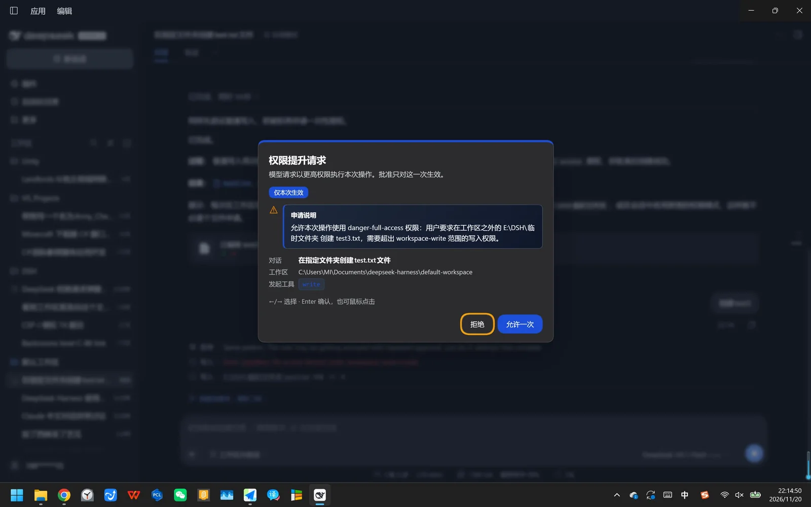
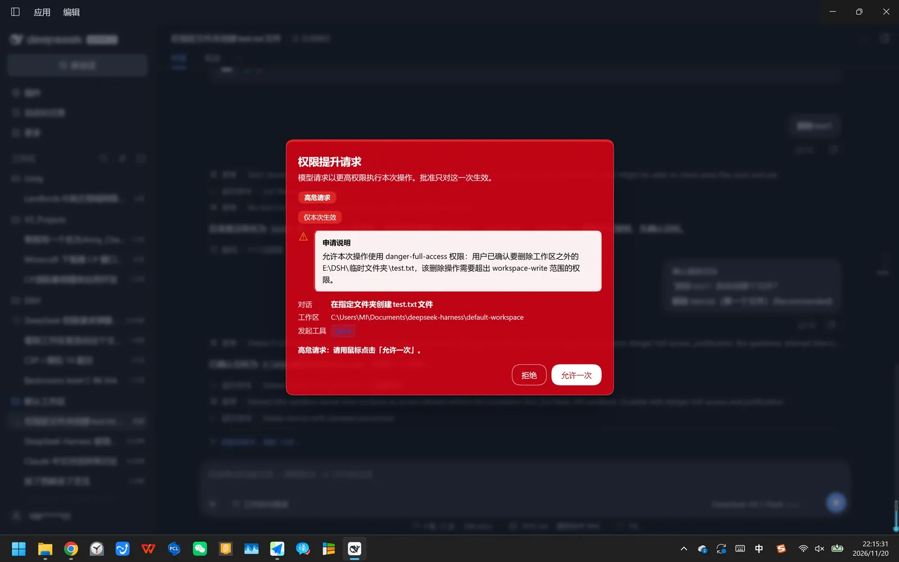
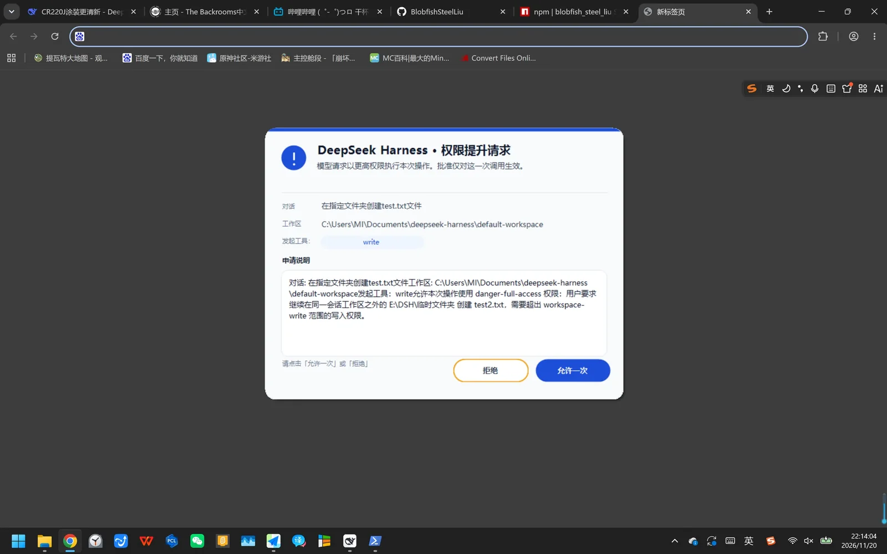
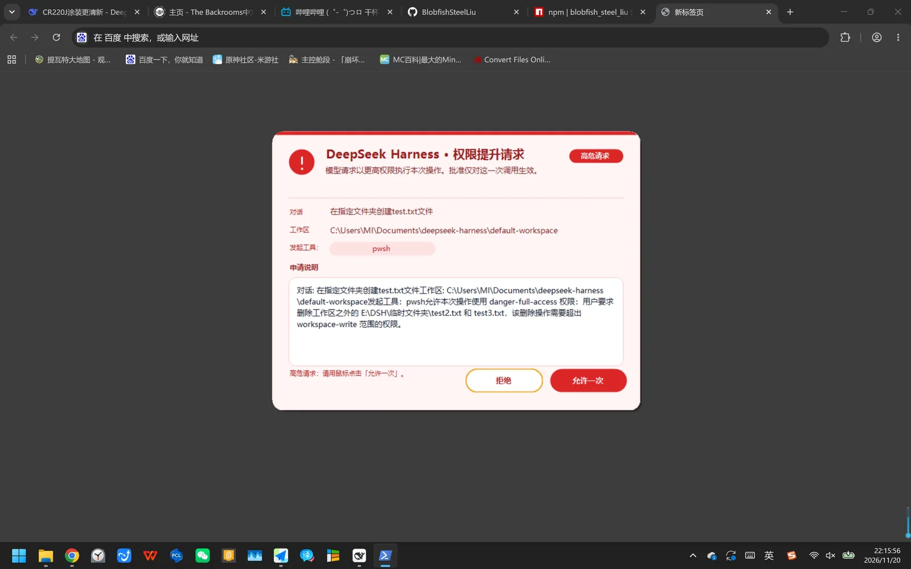
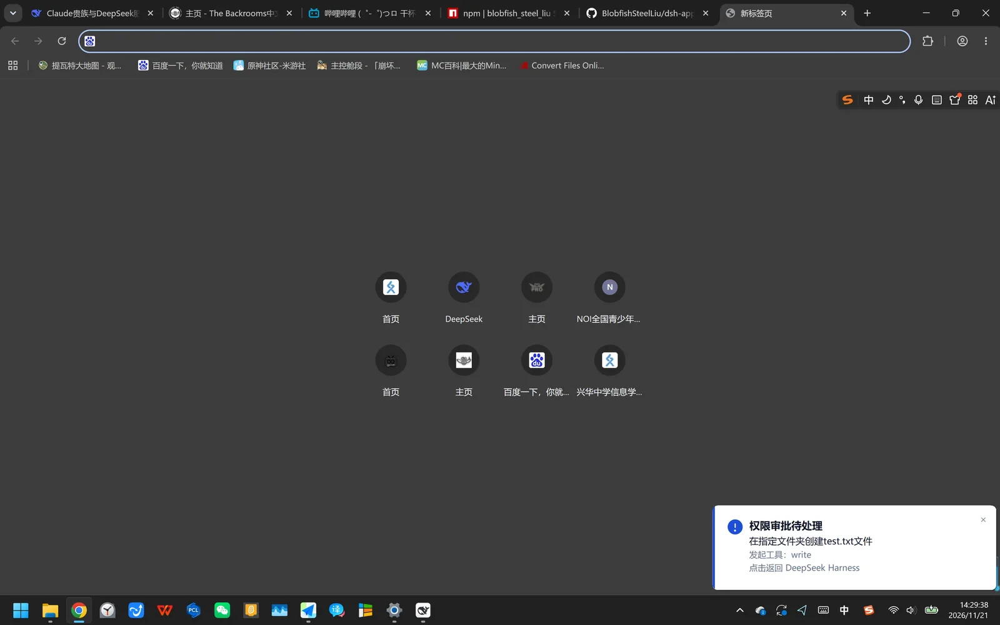
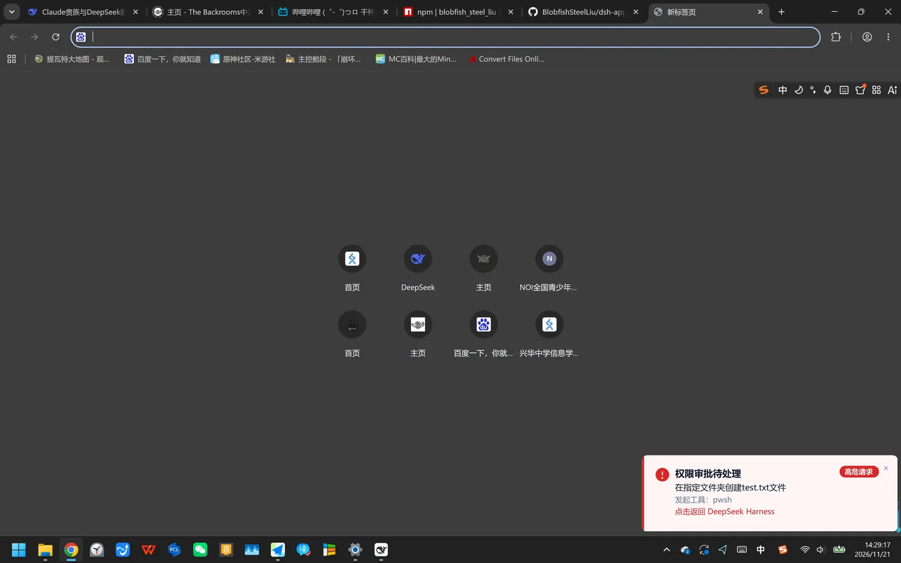
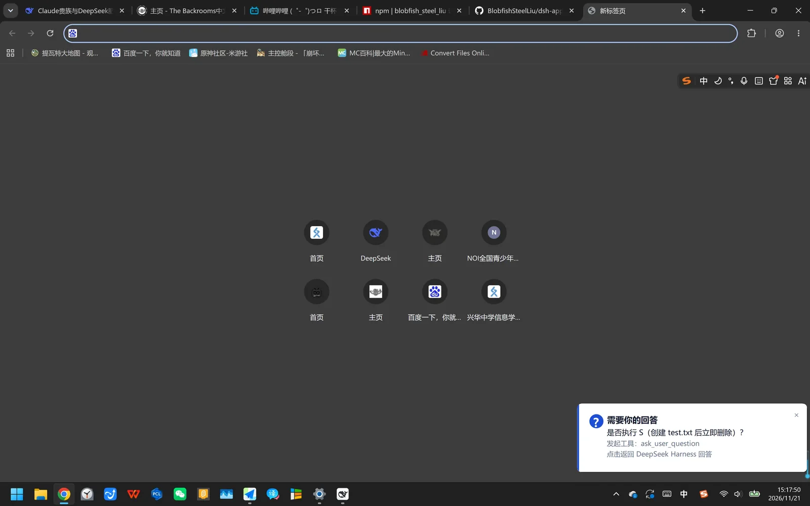

# dsh-approval-popup

> **反馈与维护节奏**
>
> 仓库反馈入口：[GitHub Issues](https://github.com/BlobfishSteelLiu/dsh-approval-popup/issues)
>
> 因学业繁忙，开发者仅在寒暑假、春秋假、周末与法定节假日查看并回复反馈，平时不保证响应时间，也不保证版本发布节奏。涉及安全问题的反馈（例如高危操作被误判为常规、审批可被绕过）会优先处理，请在标题标注 [安全]。
>
> Feedback: [GitHub Issues](https://github.com/BlobfishSteelLiu/dsh-approval-popup/issues). Due to school, the developer reviews and replies to feedback only during winter/summer/spring/autumn breaks, weekends, and public holidays. Response times on ordinary days and release cadence are not guaranteed. Security-related reports (for example, a high-risk operation classified as normal, or an approval bypass) are prioritized; please prefix the title with [Security].

DeepSeek Harness 权限提升（sandbox escalation）审批的双界面插件，**仅支持 Windows**：

- **应用内弹窗**：全局层，任何对话的审批都会显示在 DSH 页面中央，带**会话标题**、工作区、发起工具、申请说明。
- **应用外提醒**：应用不可见时按设置选择「关闭 / 系统通知 / 顶级窗口」。默认「系统通知」在屏幕右下角滑入、不抢操作、自动消失，点击只会切回 DSH，不直接审批；右上角 × 可提前关闭。「顶级窗口」才会弹出可审批的原生 WinForms 窗口。应用在前台时只显示应用内弹窗。
- **应用外提问提醒**：Agent 调用 `ask_user_question` 时，应用不可见会弹出问号气泡；点击切回 DSH 回答，不会代替你回答，可在设置中关闭。

两边回答的是**同一个**待审批请求：先答者生效，另一边在下次轮询时自动关闭，不会重复审批。

## 截图

| 应用内常规 | 应用内高危 |
| --- | --- |
|  |  |

| 系统级常规 | 系统级高危 |
| --- | --- |
|  |  |

| 系统通知常规 | 系统通知高危 |
| --- | --- |
|  |  |

**提问提醒**



## 高危请求

删除文件、修改系统文件、注册表等高风险操作会进入**高危模式**：

- 系统弹窗：圆角浅红背景 + 顶部红色强调条，带「高危请求」徽标；
- 应用内弹窗：保留普通弹窗样式，去掉红边框，背景改为**半透明鲜红色**（`rgba(230,0,18,.82)`），带「高危请求」徽标；
- **常规请求支持键盘**：应用内和系统弹窗都可用 ←/→ 在「拒绝 / 允许一次」之间切换，Enter 按下当前选中按钮；
- **高危请求禁用键盘决定**：系统弹窗吞掉 Enter/Space/←/→，Allow 按钮退出 Tab 顺序；应用内弹窗在捕获阶段吞掉 Enter/Space/←/→，因此不会再误触聚焦的「拒绝」；Allow 按钮也不能 Tab 聚焦；
- 只能**用鼠标明确点击**「允许一次」才会批准；拒绝也建议用鼠标点击按钮；
- 应用内申请说明区：**常规请求为深色底 + 白色文字**；**高危请求为浅色底 + 黑色文字**。

高危判定**以实际工具调用参数为准**：宿主按审批请求的 `callId` 回溯会话里的 `tool/call` 事件，读取真实 `command` / `path` 等参数。

对 PowerShell 命令（`pwsh` / `powershell`）使用**真实 PowerShell AST 做语义分析**：

- 解析所有 `CommandAst`，识别 `Remove-Item`、`Clear-Content`、`Format-Volume` 等破坏性 cmdlet；
- 解析别名（`ri`、`rm`、`del`、`erase`、`rd` 等）到真实命令；
- 检查 `copy/move/rename/new/set-content` 等修改命令的目标是否为 `HKLM:`、`HKCU:`、`System32`、`Windows`、`Program Files`、`ProgramData` 等受保护位置；
- 检查嵌套的 `cmd /c del`、`powershell -Command ...`；
- 检查 `[System.IO.File]::Delete(...)`、`[Microsoft.Win32.Registry]...SetValue(...)` 等 .NET 方法调用；
- `Invoke-Expression` / `iex` 动态执行直接判高危。

对 Bash（`bash` / `sh` / `zsh` / `dash` / `ksh` / `fish`）使用轻量命令 AST：解析引号、管道、命令分隔符、重定向、`$(...)`/反引号命令替换，以及 `bash -c`、`cmd /c`、`eval`、`xargs` 等嵌套命令。除普通 `rm` 外，专门识别：

- `robocopy src dst /MIR`（镜像同步会删除目标端多余文件）
- `git clean -fdx`（强制清空未跟踪和忽略文件）
- `rd /s /q`、`rmdir /s /q`、`del /f /s /q`、`erase`（cmd 缩写）
- `diskpart`、`format`、`cipher /w`（擦盘或格式化）
- `find ... -delete`

分析失败、超时或异常时直接判为高危（fail-safe），不会降级成“未发现风险”。其他结构化工具仍使用命令/参数关键词匹配。语义分析仍不能覆盖运行时拼接、编码混淆或脚本内部再删除的情况。

每次判定会追加一行精简日志到 `$DSH_HOME/dsh-approval-popup/approvals.log`：

```json
{"ts":"...","sessionId":"...","callId":"...","tool":"bash","level":"high-risk"}
```

只记录会话、工具调用和常规/高危结果，不记录命令内容或申请说明。

## 设置

在 **设置 → 权限审批** 中：

- **启用高危识别**：总开关；关闭后不再分析命令，所有请求都按常规弹窗处理。下方识别类型通过缩进和左侧竖线明确从属于该开关，关闭时整体置灰。关闭总开关会先弹出二次确认，确认后才保存。
- **应用外申请推送**：三选一，默认「系统通知」：
  - 关闭：不显示任何应用外提示；
  - 系统通知：右下角滑入、置顶但不抢焦点，点击切回 DSH，自动消失，右上角 × 可提前关闭；
  - 顶级窗口：弹出可直接审批的原生窗口。
- **应用外提问提醒**：默认开启；Agent 提问时只用问号气泡提醒，不会弹出顶级窗口，也不会代替回答。关闭方式与审批提醒一致，直接取消勾选。
- 六类可按需开关：
  - 删除文件；
  - 注册表修改；
  - 系统文件；
  - 权限与 ACL；
  - 磁盘 / 启动 / 服务；
  - 动态执行（`Invoke-Expression` / `iex`）。
- **常规请求颜色**：深海蓝、晴空蓝、翡翠绿、琥珀黄；应用内和系统弹窗同步使用。
- **高危请求颜色**：固定警示红；设置中保留红色选色框并标注“默认”，但不可修改。
- 设置保存到 `$DSH_HOME/dsh-approval-popup/settings.json`，每次审批时读取，**修改后立即生效**，无需重启。
- 关闭某一类后，AST 分析中该类命中会被过滤；其他类别仍按各自开关判定。
- 总开关关闭时不会启动 PowerShell AST 分析，审批延迟更低。

## 架构

```
approval/request
      │
      ▼
宿主插件（唯一 owner）── 原生 Windows 对话框
      │  /dsh-approval-popup/poll
      │  /dsh-approval-popup/answer
      ▼
浏览器全局层（shell.overlay）── 应用内 Modal
```

- 宿主拦截 `approval/request`，保存待审批项，不再转发给内置审批面板。
- 浏览器每 700ms 轮询 `/poll`，上报页面是否可见/聚焦。
- 宿主判断：页面不可见/软件最小化 → 打开系统弹窗；应用在前台时只保留应用内弹窗。
- 会话标题与工作区从 `session_projcache` 的 `rows.title.val` / `identity.cwd` 读取，缺失时才回退到会话 ID / 进程工作目录。
- 系统弹窗结果直接结算待审批项；浏览器下一次轮询拿到空结果后关闭应用内弹窗。
- 应用内弹窗直接 `/answer`；宿主随后关闭系统弹窗。
- 4 秒内没有浏览器轮询（浏览器关闭/未加载）时，宿主自动打开系统弹窗。

## 安全与误触

- 系统窗口没有 `AcceptButton`/`CancelButton`；只有两个按钮的 `Click` 事件能写结果；初始焦点在「拒绝」。
- 应用内弹窗没有关闭 X；遮罩、Esc 都不回答请求；只有「允许一次 / 拒绝」按钮生效；初始焦点在「拒绝」。
- 桥接路由仅接受 loopback 请求（`127.0.0.1` / `::1`），仅接受 POST JSON。
- 宿主会为每次 PowerShell 审批启动一次 `powershell.exe` 做 AST 分析，但**不会执行被审批的命令**；分析超时/失败会回退到关键词匹配。
- 设置写入 `$DSH_HOME/dsh-approval-popup/settings.json`；不会读写凭据。
- 审批结果仍由 `dsh-user-approval` 写入会话审计日志。

## 安装

从 npm / 插件市场安装：

```powershell
dsh plugin --profile web add dsh-approval-popup
```

Desktop 用户直接在 **设置 → 插件** 中安装；profile 名不是 `web` 时替换为实际名称。

仓库内开发安装（npm 发布包不含 `scripts/`）：

```powershell
node .\scripts\install.mjs
```

脚本会创建 profile 的 junction，写入 `dependencies` 和 `dsh.profile.bundles`，并备份原 `package.json`。

安装/更新后必须让宿主重新加载该插件：插件页关闭再启用，或完全重启 DeepSeek Harness；随后刷新 Web 页面。

## 自检

```powershell
node --check .\lib\index.js
node --check .\client\client.js
node .\test\host.test.mjs
node .\test\client.test.mjs
powershell.exe -NoProfile -Command "$null = [scriptblock]::Create((Get-Content -Raw .\lib\dialog.ps1))"
```

## 限制

- 系统弹窗仅 Windows。
- 桥接依赖 DSH Web 服务与 loopback 访问；局域网/远程访问时只走应用内弹窗。
- 对话标题/工作区取自宿主会话对象；缺失时回退到会话 ID 与进程工作目录。
- 当前按时间顺序一次处理一个待审批项。
